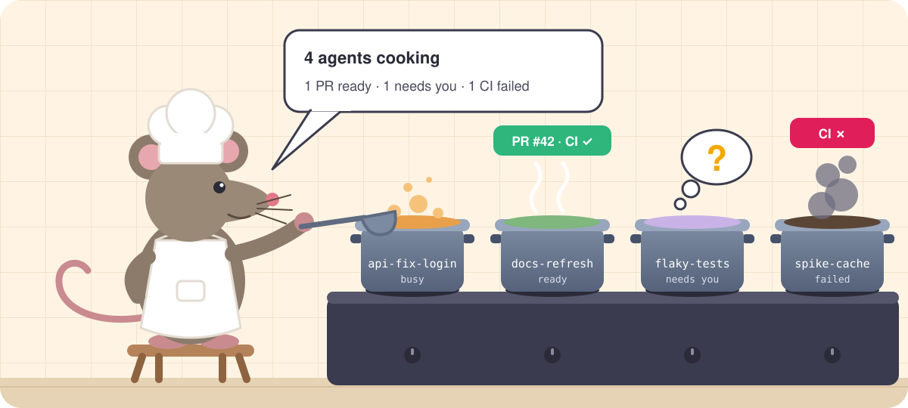

# Remy

<p align="center"></p>

Remy is a Claude Code plugin that keeps an eye on all your Claude Code sessions and talks to you in Slack or Telegram.

If you run a few agents at once, you know the routine: click through terminal tabs to see which one is done, find one that has been sitting on a question for half an hour, notice a PR went red after you'd moved on. Remy does that checking for you and messages you when something needs you.

What you get:

- A message when an agent finishes, with the PR link and CI status
- A ping when a session is stuck waiting for you. Reply in the chat and the answer goes to that session.
- A short update every 15 minutes, only if something changed
- Type "start an agent in api: fix the flaky auth test" in a DM and Remy starts one in its own worktree
- React 🐭 to a bug report in a Slack channel and an agent picks it up with the whole thread, then posts the PR back there

It runs on your laptop with your own Claude Code login. There's no server to host. In Slack it can share an app your team already has; in Telegram you make your own bot in a minute. Use one or both: work repos in the company Slack, side projects in Telegram on your phone, or the same work in both, so you can answer from your desk or your phone.

## Why

I usually have several Claude Code sessions going across a few repos, and I kept losing track of them. Starting agents was never the problem. Knowing which ones were done, stuck or broken was. I wanted one chat that knows about all of them, tells me when something needs me, and lets me answer without finding the right terminal.

Remy doesn't write code. It starts agents, checks on them and passes messages back and forth. It won't merge, close or delete anything unless you tell it to in Slack. Reviewing and merging is still on you.

## What it looks like

Run `remy start` in the morning and leave that terminal open. Remy posts what's already running:

```
remy: Morning. 3 sessions running:
      • brioche · web · idle · PR #212 · CI ✓
      • risotto · api · busy · no PR
      • pesto · docs · waiting for you
```

Give it work and get on with yours:

```
you:  start an agent in api: the invoice export times out for big accounts, fix it and open a PR
remy: Started saffron in api. I'll report here.
```

Someone posts a bug in `#bugs`. React with 🐭, or reply in the thread mentioning the bot (`@remy fix this`, using your bot's name). Remy adds 👀 and starts an agent. Updates go in the same thread, so whoever reported the bug sees the PR too:

```
remy: Started bugs-login-timeout in web.
      …
remy: bugs-login-timeout · web · done · PR #219 · CI ✓
      Session cookie TTL was 30 s after the auth refactor; set back to 30 min, added a test.
```

When an agent has a question, it comes to you. Your answer goes straight to the agent:

```
remy: saffron is asking: stream the CSV, or generate it in a background job and email a link?
you:  stream it, accounts are under 50k rows
remy: Sent to saffron.
```

Instead of a message per finished agent, Remy keeps one pinned message that lists what waits on you, most urgent first, and edits it in place as things change. Read the top line and do that:

```
Waiting on you (3)
🔴 saffron · asks: "stream the CSV, or a background job?" → reply to its thread
🟠 risotto · CI failing: unit-tests → reply "fix CI"
🟢 brioche · PR ready for you → review it
2 more working on their own
```

🔴 is a question or permission, 🟠 red CI, 🟡 requested changes, 🟢 a PR ready for review, ⚪ an agent that stopped without a PR. Edits don't notify you; only questions do. Telegram pins the message; in Slack it stays where it was first posted. Send `/queue` to the bot to get the list as a fresh message at the bottom of the chat; `remy queue` prints it in a terminal.

Every 15 minutes you get a short note about merged PRs and ended sessions, if there were any. Remy writes it itself, not the coordinator, so it reads the same every time:

```
✅ saffron · api · PR #212 merged
⏹️ pesto · docs · ended · session closed
```

Everything else is on the list.

You review and merge PRs like you always do. Once an agent's PR is merged, Remy closes that agent within about a minute and tells you: `claude rm` deletes the session and its worktree, or, if the worktree still has uncommitted or unpushed work, `claude stop` ends the session and the worktree stays. The agent then counts as merged: it's left out of `remy status`, and `remy status --merged` lists it. Remy only does this for agents it started (`remy spawn`), never for sessions you started yourself, and waits while an agent is mid-turn.

Telegram works the same way, in your chat with your bot. Telegram has no threads there, so each agent's messages come as a reply chain: reply to any of them to talk to that agent. Right after an agent asks you something, a plain message works too. When the coordinator itself needs a permission, you get Allow / Deny buttons.

## Tips

- Put your usual routine in `spawnTemplate`, e.g. `/start-feature {task}`. Every agent Remy starts then branches, tests and opens a PR the way you would.
- Sessions you start yourself show up too. Remy only pings you about one if it's been stuck for about a minute, so it won't bother you about a session you're watching.
- Every session gets a short kitchen name, like `saffron` or `risotto`, that's easy to type from your phone. A session you named yourself (`claude -n`, `/rename`) keeps its name.
- Each agent gets its own Slack thread, or reply chain in Telegram. Reply there to talk to that agent.
- Ask things like "what's risotto doing?" and Remy checks with the agent or reads its log.
- Teammates can install it too. Each person runs their own Remy on their own Claude subscription, and only your own messages and 🐭 reactions reach yours.

## How it works

| Piece | What it does |
|---|---|
| Plugin hooks (`Stop`, `Notification`, `SessionEnd`) | Every session appends its events to `~/.remy/events.jsonl` |
| Plugin hook (`UserPromptSubmit`) | Names a session that has no name yet after a dish or ingredient (`src/kitchen-names.ts`), on its first prompt, and keeps that prompt in `~/.remy/nicknames.json` as what the session is about |
| `remy status` | Joins `claude agents --json`, each session's git branch and `gh pr view` |
| `src/queue.ts` | Ranks what waits on you from that snapshot; the daemon keeps it as one message per workspace (`~/.remy/queue.json`) |
| `remy daemon` (`src/daemon.ts`) | The long-running process. Reads your messages in each workspace, tails session events, keeps the waiting list, posts the merged/ended notices itself (`src/notices.ts`), runs extensions and relays the coordinator's permission prompts. Holds what it would push while the coordinator is down |
| `src/extensions/` | The extension API (`api.ts`), the host that runs extensions in the daemon, and the built-in ones: closing merged agents, Slack-thread tasks, `/queue` |
| `remy` channel (`src/channel.ts`) | Runs inside the coordinator session only. A thin client of the daemon over `~/.remy/daemon.sock` (`src/link.ts`): pushes the daemon's events into the session and gives Claude `post` / `update` |
| `src/bridges.ts` | Picks the Slack or Telegram bridge for each workspace; both implement `Messenger` (`src/messenger.ts`) |
| `src/slack-bridge.ts` | Slack: your DM with the bot (polling or Socket Mode), plus your mentions of the bot and your 🐭 reactions in the channels it's in (`src/watch.ts`) |
| `src/telegram-bridge.ts` | Telegram: your chat with your bot, read by long polling, with Slack-style formatting converted to Telegram's (`src/telegram-format.ts`) |
| `remy spawn` | `claude --bg -n <kitchen-name> -w <repo-and-task> --permission-mode auto "<task>"` in the chosen repo |
| `coordinator.md` | The coordinator's instructions, appended to its system prompt |

Messages to other sessions go through Claude Code's built-in `SendMessage`.

## Requirements

- macOS or Linux, Claude Code 2.1.224+, [Bun](https://bun.sh), `gh` logged in
- Claude Team/Enterprise: an admin turns on **Channels** (Organization settings → Claude Code → Channels)
- A Slack app with a bot user (an existing app works), or a Telegram bot of your own, or both

## Workspaces

A workspace is where Remy talks to you about a set of sessions: in Slack, in Telegram, or both. You can have several, for example "work" and "personal". Each session reports to one workspace: give a workspace `repos` (GitHub `owner/name`, `*` allowed) or `paths` (folders), and the workspace with neither gets everything else. Repo matching follows a repo into its worktrees, wherever they live. One coordinator serves all workspaces.

### Slack and Telegram together

A workspace with both apps works in one of three ways (`both` in the config):

| Mode | What happens |
|---|---|
| `mirror` (default) | Everything goes to both. What you write in one shows up in the other, so both read as the same conversation. Answer from either. |
| `pings` | Everything goes to the `main` app. The other gets only questions and permission prompts, so your phone buzzes when an agent needs you. |
| `follow` | Messages go to whichever app you last wrote from (`main` until you have). |

A question answered in one app stops counting as open in the other. If one of the two apps is broken (say a Slack app still waiting for approval), the workspace keeps working through the other.

A Slack workspace also picks how remy reads your DMs:

| Transport | Use when | Delay | Slack app setup |
|---|---|---|---|
| `poll` | Teammates share the Slack app | 4–15 s | Bot scopes only |
| `socket` | Only you run remy with this app | Instant | Bot scopes + Socket Mode + app-level token |

Socket Mode can't serve a shared app: Slack hands each event to any one open connection, so your DM could land on a teammate's laptop.

### Slack app

At api.slack.com/apps → your app (an existing app works):

1. **OAuth & Permissions** → **Bot Token Scopes**: `chat:write`, `im:history`, `im:read`, `im:write`. Reinstall the app and copy the bot token (`xoxb-…`).
2. **App Home** → turn on the **Messages Tab** and allow users to send messages.
3. For tasks from channel threads, also add `channels:read`, `groups:read`, `channels:history`, `groups:history`, `reactions:read`, `reactions:write`, `users:read` and `files:read`, then `/invite` the bot to the channels you want to use it in. `remy doctor` lists what's missing.
4. For `socket` only:
   - **Socket Mode** → enable.
   - **Basic Information** → **App-Level Tokens** → create one with `connections:write` (`xapp-…`).
   - **Event Subscriptions** → enable → **Subscribe to bot events** → `message.im`.

With `poll`, remy adds no event subscriptions and doesn't need Socket Mode, so anything the app already does (for example posting alerts through incoming webhooks) keeps working. Several people can share one app in `poll` mode: each remy reads only its owner's DM. Anyone holding the bot token can read every DM with the bot, so share it only within a trusted team.

### Telegram bot

1. In Telegram, message [@BotFather](https://t.me/BotFather), send `/newbot` and pick a name. It replies with a token (`123456789:AA…`).
2. Run `remy setup`, choose `telegram` for the workspace and paste the token.
3. Setup asks you to open the bot and press **Start**. It reads that first message to learn your Telegram ID, so only you can talk to your remy.

Make a new bot for remy. Telegram gives a bot's messages to one program only, so a bot can't be shared with teammates, the Telegram channel plugin or another remy. Anyone can find a bot and write to it; remy ignores everyone but you.

## Install

```sh
claude plugin marketplace add t9builds/remy
claude plugin install remy@remy
```

Restart your Claude Code sessions so they load the hooks. Then, in a terminal:

```sh
~/.claude/plugins/cache/remy/remy/*/bin/remy setup   # first time; afterwards just `remy`
remy start
```

`remy setup` walks you through it: your repo folders, the prompt for spawned agents and the digest interval, then each workspace. For a workspace you pick Slack or Telegram and which repos or folders report there. Then either your Slack member ID (Slack → profile → ⋮ → Copy member ID), how to read your DMs and the bot token, or your Telegram bot token and a pairing message. Tokens are checked with Slack or Telegram before they're saved to the macOS keychain (`~/.remy/*-token.<workspace>` on Linux). Setup sends you a test message in each workspace, installs `~/.local/bin/remy` and ends with `remy doctor`. `remy setup <workspace>` edits one workspace.

`remy start` starts the daemon if it isn't running, then opens the coordinator. Accept the development-channel warning; custom channels need it during the research preview. Keep the terminal open. If one workspace is broken (say a Slack app still waiting for approval), Remy starts with the ones that work, warns you, and sends the broken one's sessions to a working workspace until you fix it (`remy setup <workspace>`, then `remy start`).

### The daemon

Slack, Telegram, session events, the waiting list, the merged/ended notices and closing merged agents live in `remy daemon`, a background process that keeps running when the coordinator exits, restarts or compacts. Messages that arrive while the coordinator is down wait in the daemon, across its own restarts too, and reach the coordinator when it's back.

`remy start` starts the daemon in the background when none is running, and restarts it when the plugin was updated or the config changed since it started. `remy setup` stops it while you set up, `remy daemon stop` stops it, and `remy doctor` shows whether it's running. Its log is `~/.remy/daemon.log`.

### Run the daemon as a service

To keep the daemon up across logins and crashes, let launchd or systemd run it. Both use the `~/.local/bin/remy` command that `remy setup` installs, which always runs the installed plugin, and the `PATH` of the shell you run this in, so `bun`, `claude` and `gh` are found.

macOS (launchd):

```sh
cat > ~/Library/LaunchAgents/remy.daemon.plist <<EOF
<?xml version="1.0" encoding="UTF-8"?>
<!DOCTYPE plist PUBLIC "-//Apple//DTD PLIST 1.0//EN" "http://www.apple.com/DTDs/PropertyList-1.0.dtd">
<plist version="1.0">
<dict>
  <key>Label</key><string>remy.daemon</string>
  <key>ProgramArguments</key><array><string>$HOME/.local/bin/remy</string><string>daemon</string></array>
  <key>EnvironmentVariables</key><dict><key>PATH</key><string>$PATH</string><key>REMY_DAEMON_SERVICE</key><string>1</string></dict>
  <key>WorkingDirectory</key><string>$HOME</string>
  <key>RunAtLoad</key><true/>
  <key>KeepAlive</key><dict><key>SuccessfulExit</key><false/></dict>
  <key>StandardOutPath</key><string>$HOME/.remy/daemon.log</string>
  <key>StandardErrorPath</key><string>$HOME/.remy/daemon.log</string>
</dict>
</plist>
EOF
launchctl bootstrap gui/$(id -u) ~/Library/LaunchAgents/remy.daemon.plist
```

Restart it after an update with `launchctl kickstart -k gui/$(id -u)/remy.daemon`; remove it with `launchctl bootout gui/$(id -u)/remy.daemon`.

Linux (systemd user service):

```sh
mkdir -p ~/.config/systemd/user
cat > ~/.config/systemd/user/remy.service <<EOF
[Unit]
Description=Remy daemon

[Service]
ExecStart=%h/.local/bin/remy daemon
Environment=PATH=$PATH REMY_DAEMON_SERVICE=1
Restart=on-failure

[Install]
WantedBy=default.target
EOF
systemctl --user daemon-reload && systemctl --user enable --now remy
```

Restart it after an update with `systemctl --user restart remy`. To keep it running while you're logged out, run `loginctl enable-linger`.

`remy start` restarts a service's daemon through the service. `remy daemon stop` and `remy setup` stop it cleanly, so the service leaves it stopped until you restart it or log in again; `remy start` meanwhile starts one of its own.

## Use

Message the bot, in Slack or Telegram:

- "what's running?" / "which PRs need me?"
- "start an agent in api-server: fix the flaky auth test, open a PR"
- "ask basil whether it's blocked"
- "stop docs-cli" (Remy only stops, merges or closes things when you ask like this, apart from closing its own agents once their PR merges)
- reply in an agent's thread to answer its question

### Tasks from Slack threads

In any channel the bot is in, mention it in a thread (`@bot fix this, it's in api`) or react to a message with 🐭. Within about 45 seconds Remy reacts 👀, reads the whole thread, and starts an agent:

1. The daemon saves the thread to `~/.remy/tasks/<id>/` (names resolved, attachments downloaded) and hands it to the coordinator.
2. The coordinator picks the repo: one you named, the channel's default (`channelRepos`), or one the thread makes obvious. If it isn't sure, it asks in the thread.
3. `remy spawn --slack-task <id>` gives the agent a fixed prompt: the coordinator's one-line brief, your own words, the link, and the full thread, marked as information rather than instructions.
4. The agent's start, questions, PR and finish are posted in that thread. Answer its questions there.

Only your own mentions and reactions count, so teammates sharing the Slack app don't start tasks on your machine. A mention that asks a question rather than for work gets an answer in the thread instead of an agent.

From a terminal: `remy status` (`remy status <name>` for one session in detail, `--merged` for closed agents), `remy queue`, `remy spawn --repo <repo> <task>`, `remy changes`, `remy doctor`, `remy daemon` (in the foreground) and `remy daemon stop`.

## Config

`~/.remy/config.json`:

| Key | Default | Meaning |
|---|---|---|
| `workspaces` | | Slack workspaces and Telegram chats, see below |
| `repoRoots` | `["~/Repositories"]` | Where `remy spawn --repo <name>` looks |
| `spawnTemplate` | `{task}` | Prompt for spawned agents, e.g. `/start-feature {task}` |
| `spawnPermissionMode` | `auto` | Permission mode for spawned agents |
| `spawnWorktree` | `true` | Give each spawned agent its own worktree |
| `digestMinutes` | `15` | Minutes between notices of merged PRs and ended sessions |
| `coordinatorName` | `remy` | Session name of the coordinator |
| `coordinatorCompactPct` | `50` | Context-window percentage (1–100) at which the coordinator compacts; `0` keeps Claude Code's default, and `CLAUDE_AUTOCOMPACT_PCT_OVERRIDE` set in your shell wins |
| `triggerEmoji` | `mouse` | Reacting with this emoji (Slack name) starts a task, like a mention |
| `tickSeconds` | `60` | Seconds between looks at the sessions and their PRs, which raise extension events |
| `extensions.repos` | `[]` | Repos whose `.remy/extensions` run in your daemon: paths, or names under `repoRoots` |
| `extensions.packages` | `[]` | Extension packages installed in `~/.remy` |
| `extensions.disabled` | `[]` | Extensions not to load, by name, built-in ones included |

Each workspace:

| Key | Meaning |
|---|---|
| `name` | Short label, e.g. `work`; names its tokens and state files |
| `repos` | GitHub repos whose sessions report here, e.g. `["acme-corp/*"]`; checked first |
| `paths` | Folders whose sessions report here |
| `slack.userId` | Your Slack member ID there; only this user can talk to your remy |
| `slack.transport` | `poll` or `socket` |
| `slack.channelRepos` | Default repo per channel for thread tasks, e.g. `{ "bugs": "api" }` |
| `telegram.userId` | Your Telegram user ID, set by pairing in `remy setup`; only this user can talk to your remy |
| `both` | With Slack and Telegram: `mirror` (default), `pings` or `follow` |
| `main` | The app that gets everything with `pings`, and the one `follow` starts with: `slack` (default) or `telegram` |

Leave out both `repos` and `paths` for the catch-all workspace. Configs from before 0.6, with flat `slackUserId` / `messenger` fields, are read as before.

```json
{
  "workspaces": [
    {
      "name": "work",
      "repos": ["acme-corp/*"],
      "slack": { "userId": "U012ABC", "transport": "poll" },
      "telegram": { "userId": 123456789 },
      "both": "pings",
      "main": "slack"
    },
    { "name": "personal", "telegram": { "userId": 123456789 } }
  ]
}
```

Each workspace with Telegram needs a bot of its own (`remy doctor` flags two sharing one), so the example above uses two bots.

A path covers the folder and everything inside it, not sibling folders that share its prefix, so prefer `repos` when worktrees sit next to the main checkout. Tokens can also come from `REMY_SLACK_BOT_TOKEN_<WORKSPACE>`, `REMY_SLACK_APP_TOKEN_<WORKSPACE>` and `REMY_TELEGRAM_BOT_TOKEN_<WORKSPACE>`.

## Extensions

Everything Remy does beyond relaying messages, tracking sessions and keeping the waiting list is an extension: a TypeScript module that reacts to Remy's events and acts through its API. Remy's own behaviors are built-in extensions written against the same API (`src/extensions/builtin/`): `merged-cleanup` closes agents whose PR merged, `slack-tasks` hands tasks from Slack threads to the coordinator, and `queue` answers `/queue`. Turn one off with `extensions.disabled` and write your own instead.

```ts
// ~/.remy/extensions/red-ci.ts
import type { Remy } from "<remy plugin folder>/src/extensions/api";

export default (remy: Remy) => {
  remy.on("pr.ci", async ({ session, pr }) => {
    if (pr.ci === "fail" && session.spawned) await remy.post(`🟠 *${session.name}*: CI failed on <${pr.url}|#${pr.number}>`, { session: session.name });
  });
  remy.registerCommand("standup", { description: "What my agents did today", run: () => remy.sessions().map((s) => s.name).join(", ") });
};
```

| Events | |
|---|---|
| `session.started`, `session.asks`, `session.stopped`, `session.ended` | A session appeared, waits for you (a question, or blocked on input), ended its turn, is gone |
| `pr.opened`, `pr.ready`, `pr.ci`, `pr.merged` | A session's PR opened, left draft, finished CI (pass or fail), merged |
| `message` | You wrote in a workspace, or started a task from a Slack thread |
| `tick` | Every `tickSeconds`, after Remy looked at the sessions again |

| Actions | |
|---|---|
| `post(text, { workspace, session, thread })` | Post to you |
| `ask(question, { session })` | Ask you and wait: it's on the waiting list until you reply in its thread, and the reply goes to the extension, not the coordinator |
| `spawn({ repo, task })`, `close(session)` | Start an agent, close a session |
| `queue.add(entry)`, `queue.remove(key)`, `queue.text(workspace)` | Put something on the waiting list, take it off, read the list |
| `coordinator.tell(text)` | Hand something to the coordinator for a turn |
| `registerCommand(name, { description, run })` | Answer `/name` in any workspace, without the coordinator |
| `state.get` / `state.set` | A small JSON store of the extension's own (`~/.remy/state/`) |
| `sessions()`, `log(…)` | Sessions as last seen; write to the daemon's log |

Extensions load from three places:

| Folder | Whose |
|---|---|
| `~/.remy/extensions/` | yours: each `*.ts` file, or folder with an `index.ts` |
| `<repo>/.remy/extensions/` | the team's, versioned with the code; only for repos listed in `extensions.repos` |
| packages in `extensions.packages` | anyone's; install them with `cd ~/.remy && bun add <package>` |

An extension runs in the daemon with your tokens and can post, start agents and close them. Installing one is a trust decision, like adding a dependency with write access, which is why a repo's extensions run only once you list the repo. `remy doctor` shows which extensions loaded and why any failed; restart the daemon after adding or changing one (`remy daemon stop`, then `remy start`, or restart its service).

## Limits

- A message from another session can't approve a permission prompt. When an agent waits on one, remy tells you to `claude attach <name>`. Spawned agents run in auto mode, so this is rare.
- The coordinator's own permission prompts are relayed to the chat: reply `yes <id>` or `no <id>`, or tap the buttons in Telegram.
- With `poll`, Slack replies arrive within about 4 seconds while you're chatting and 15 seconds when idle. Slack allows about 50 reads a minute per app, shared by everyone using it, which is enough for 3–4 active people. `socket` is instant.
- The coordinator's own permission prompts go to the workspace you last wrote from (the catch-all until you've written).
- Sessions that aren't in a git checkout (for example started in `~/Repositories` itself) show without a repo or PR.
- Channel tasks are polled every 45 seconds. A mention is found when its thread's first message is among the channel's latest 100; a 🐭 is found anywhere through `reactions.list`.
- Telegram is your private chat only: no tasks from groups, and Remy reads text, not photos or voice messages.
- Custom channels are a Claude Code research preview and may change.

## Develop

```sh
bun install
bun test && bun run typecheck
bun run build   # bundles src/channel.ts and src/cli.ts (which runs the daemon) into dist/, which is committed
bun src/cli.ts status   # run the CLI from source
```
